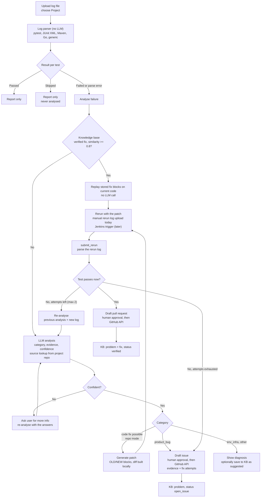
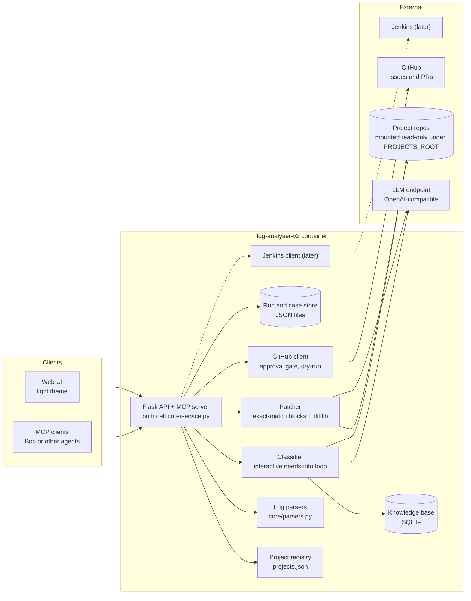
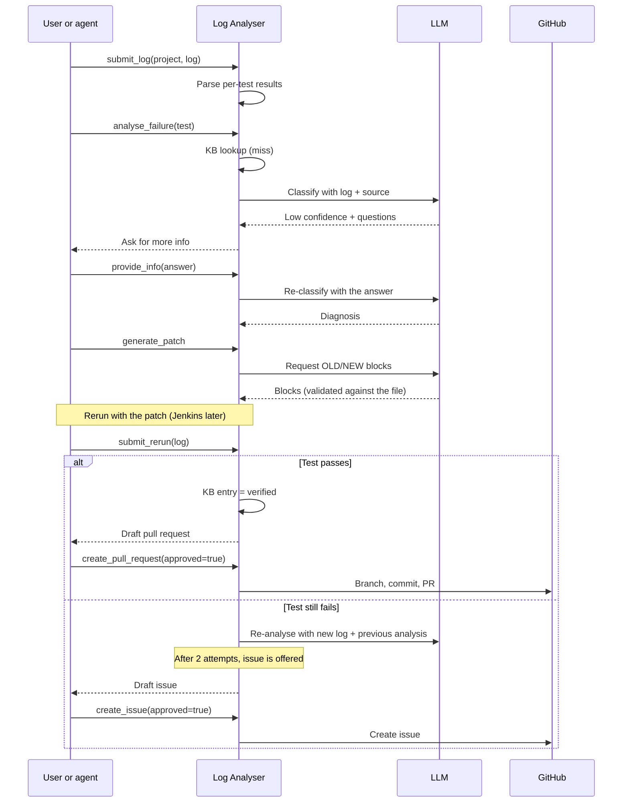

# Log Analyser v2 - Flow and Architecture

Share this file with the team. The diagrams render on GitHub, GitLab and in VS Code (Mermaid).
Items marked **(later)** are designed but not built yet.

## 1. End-to-end flow

## 2. Components

## 3. Project registry entry

| Field | Example |
|---|---|
| `name` | `ocs-ci`, `payments-java` |
| `path` | sub-folder of `PROJECTS_ROOT` containing the repo (missing folder = generic mode) |
| `log_format` | `auto`, `pytest`, `junit`, `go`, `maven`, `generic` |
| `github_repo` | `org/repo` for issues and PRs (falls back to `GITHUB_REPO`) |
| `domain_hint` | free text added to the classifier prompt |
| Jenkins job and parameters **(later)** | job name; parameters for branch and test selector |

## 4. Re-analysis loop

## 5. Decisions worth explaining in the demo

- The parser is deterministic: pass/fail/skip never depends on the LLM.
- The KB reuses only **verified** fixes (a rerun passed) and replays them with exact-match blocks, so a stale fix fails safely and falls back to the LLM.
- A timeout is a symptom: without a stated awaited operation, confidence is capped and the user is asked questions.
- Nothing is published without `approved=true`; `GITHUB_DRY_RUN` allows rehearsals.
- Repositories are read-only inputs; PRs are created through the GitHub API.
